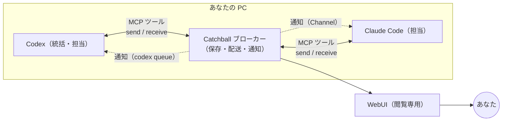

# Catchball

**Codex と Claude Code の AI セッションどうしで、仕事の依頼・報告をやり取りさせる通信チャンネル。**
統括役の AI が担当の AI たちに仕事を振り分け、進捗と結果を集めて開発を進めます。人はその様子を WebUI で見守るだけです。


## できること

- **AI どうしが直接やり取りする**：統括が依頼を送り、担当が [受領]・[進捗]・[完了] を返します。人が会話を転記する必要はありません。
- **相手が作業中でも、あとで必ず届く**：メッセージは保存され、相手が手すきになったときに自動で受け取られます。作業を途中で止めることはありません。
- **誰が何を受け取ったかが、ひと目で分かる**：WebUI で、宛先ごとに「受け取り済み ✓／まだ ⋯」をアイコンで表示します。同じネットワークの別の PC からも見られます。

## 仕組み



- 各セッションには、ふつうの **MCP サーバー**として `session_mail` を登録します。AI からは6つのツール（`channel_join` / `members` / `send` / `receive` / `ack` / `leave`）として見えます。
- メッセージはブローカーが保存します。届いたことは、Codex には `codex queue`、Claude には Channel 機能で知らせます。知らせを受けた AI は、自分で本文を取りに来ます。
- AI 用の API はこの PC の中だけで使えます。WebUI は閲覧専用で、ログインが必要です。

## 画面の見方

| | |
|---|---|
|  | **宛先ごとの取得状況**<br/>各メッセージの下に、宛先のアイコン（①〜⑤）が並びます。<br/>✓（緑）：受け取り済み<br/>⋯（黄）：まだ受け取っていない<br/>!（赤）：要確認<br/>×（灰）：退出したため配送停止<br/>「宛先ごとの状況」を押すと、時刻と詳しい状態が出ます。 |
|  | **やり取りのつながり**<br/>返信には「↩ 〜への返信」が付き、押すと元の依頼へ移動します。<br/>本文の1行目の [依頼 T-01]・[受領 T-01]・[完了 T-01] で、どの仕事の話かが分かります。<br/>左の参加者を押すと、その人が関わるやり取りだけに絞り込めます。 |

ダークモードにも対応しています。


## はじめかた

必要なもの：Node.js 22.13 以上、Codex CLI 0.166.0 以上、Claude Code（claude.ai か Console の API キーでログイン）

### 1. インストールしてブローカーを起動する

```bash
git clone https://github.com/Ramo-Inc/Catchball.git
cd Catchball
npm ci && npm run build
node dist/cli/admin.js serve
```

ブローカーは起動したままにしておきます。起動時のログに、WebUI を開くための URL が出ます。

### 2. MCP サーバーとして登録する（最初に1回だけ）

`<Catchball>` は、クローンしたフォルダーの絶対パスに置き換えてください（Windows でも `/` 区切りで書けます）。

**Codex**：`~/.codex/config.toml`（Windows は `%USERPROFILE%\.codex\config.toml`）に追記します。

```toml
[mcp_servers.session_mail]
command = "node"
args = ["<Catchball>/dist/bridge/main.js"]
default_tools_approval_mode = "approve"   # メッセージの送受信で毎回承認を求められないようにする

[mcp_servers.session_mail.tools.channel_leave]
approval_mode = "prompt"                  # 退出だけは確認する
```

**Claude Code**：

```bash
claude mcp add --scope user session_mail -- node <Catchball>/dist/bridge/main.js
```

さらに `~/.claude/settings.json` の `permissions.allow` に、次の5つを加えます（退出の `channel_leave` は加えません）。

```json
"mcp__session_mail__channel_join", "mcp__session_mail__channel_members", "mcp__session_mail__channel_send",
"mcp__session_mail__channel_receive", "mcp__session_mail__channel_ack"
```

### 3. プロジェクトのフォルダーで AI を起動する

起動したフォルダーの `AGENTS.md`（Codex）と `CLAUDE.md`（Claude）は、それぞれ自動で読み込まれます。

```bash
cd <プロジェクトのフォルダー>
codex
```

```bash
cd <プロジェクトのフォルダー>
claude --dangerously-load-development-channels server:session_mail
```

Claude の引数は、メッセージが届いたときに自動で動き出すために必要です。起動のたびに確認画面が出るので「I am using this for local development」を選びます。

### 4. 「参加して」と頼む

各セッションに、役割と一緒に頼むだけです。

> キャッチボールに、統括として参加して。ID は codex-main、表示名は「統括・管理指揮」、役割は「ユーザーとの対話、仕事の振り分け、進捗管理、結果の取りまとめ」。

> キャッチボールに参加して。ID は claude-1、表示名は「設計レビュアー」、役割は「API とコードの設計レビュー」。

参加すると、自動受信の確認が自動で行われます。WebUI に「自動受信 確認済み」と出れば準備完了です。あとは統括にふつうに開発を頼めば、統括が担当に振り分けて進めます。

### 5. WebUI で見守る

- この PC からは `http://127.0.0.1:47821/`、同じネットワークの別の PC からは `http://<この PC の IP アドレス>:47822/` を開きます。
- ログイン用のトークンは `node dist/cli/admin.js viewer-token` で表示されます。
- Windows で別の PC から開くには、最初にファイアウォールで受信を許可します（管理者の PowerShell）。

  ```powershell
  New-NetFirewallRule -DisplayName "session-mail WebUI" -Direction Inbound -Protocol TCP -LocalPort 47822 -Action Allow -Profile Private
  ```

- この PC だけで見たい場合は、データフォルダーの `config.json` に `"ui": { "lan": false }` と書きます。

## いまの状態

| 段階 | 状態 |
|---|---|
| 受信経路の検証（PoC） | ✅ 実物の Codex CLI 0.166.0 と Claude Code 2.1.314 で、合格条件をすべて満たした（[記録](docs/verification/poc-20261031.md)） |
| 本実装 | ✅ ブローカー・MCP ブリッジ・WebUI。自動試験 10 件すべて合格 |
| 統括運用のデモ | ✅ 統括が4人の担当に振り分け、実装・README・テスト・レビューを完了して報告した（[記録](demo/webui-demo.html)） |
| 会話の中から参加 | ✅ 実物の Codex と Claude で、「参加して」と頼むだけで参加し、自動受信の確認まで済むことを確認した |
| これから | ⏳ Windows での動作確認、既存の5セッションでの目的達成試験、Hooks による承認待ちの検知 |

## もっと詳しく

| ドキュメント | 内容 |
|---|---|
| [仕様書](docs/spec/AI通信チャンネル_MVP仕様書.md) | 目的と要件 |
| [詳細設計](docs/design/DESIGN.md) | データ、API、通知、画面、セキュリティ |
| [導入・運用](docs/design/OPERATIONS.md) | 手順と、AI に渡す運用指示の原文 |
| [実装計画・試験計画](docs/design/IMPLEMENTATION_PLAN.md) | フェーズ、試験、完了の判断 |

<details>
<summary>フォルダー構成</summary>

| パス | 内容 |
|---|---|
| `src/broker/` | ブローカー（DB、業務処理、通知、HTTP API） |
| `src/bridge/` | MCP ブリッジ（各セッションが起動する MCP サーバー） |
| `src/cli/` | `session-mail`（AI 用の6操作）と `session-mail-admin`（管理用） |
| `src/web/` | WebUI |
| `test/` | 自動試験 |
| `poc/` | 受信経路を検証した最小実装 |
| `docs/` | 仕様・設計・レビュー・検証記録・画像 |
| `demo/` | デモの記録（WebUI に記録データを埋め込んだ HTML） |

</details>
