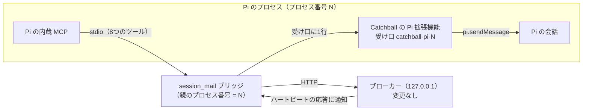

# 設計：Pi（pi-coding-agent）の参加と自動受信

> **この文書は実装前に書いた設計書で、記録として残しています。** 今の動きは [ARCHITECTURE](../ARCHITECTURE.md)・[OPERATIONS](../OPERATIONS.md) で確かめてください。 何をするかは [pi-integration.md](pi-integration.md)（仕様書）にあります。この文書には、どう作るかと、その根拠になった調査・試作をまとめます。文中の「今の作り」は、2026-11-02 の `main` を指します。

- 状態：**実装済み**（2026-11-02。D-020。実物の Pi で確認：[verification/pi-20261102.md](../verification/pi-20261102.md)）
- 対象の Pi：`@earendil-works/pi-coding-agent` 1.5.0（`earendil-works/pi`。コミット ff2c893 を読んだ）
- 方針：**Codex・Claude Code とまったく同じ機能・同じ使い方にする。** 変えるのは、ブリッジの2か所と、通知を受け取るだけの Pi 拡張機能

## 1. 調べたこと

### 1.1 Pi の作り（公式のドキュメントとソース）

| 項目 | 分かったこと | 出どころ |
|---|---|---|
| MCP | 内蔵している。`~/.pi/agent/mcp.json` に、ほかの MCP クライアントと同じ形（`mcpServers`）で書く | docs/mcp.md |
| ツールの見せ方 | 既定は `codemode` で、ツールはモデルに直接は見えない。`exposure: "direct"` にすると、組み込みのツールと同じように見える。名前は `mcp__<サーバー>__<ツール>` | docs/mcp.md「Control tool exposure」 |
| 接続名 | MCP の `clientInfo.name` は `pi` | `packages/coding-agent/src/extensions/mcp/runtime.ts` |
| サーバーの起動 | `crossSpawn` で、シェルを通さずに直接起動する。環境変数は、Pi の環境をすべて引き継ぐ | `packages/mcp/src/transports/stdio.ts` |
| サーバーからの通知 | 受け手があるのは、ログ（`notifications/message`）とツール一覧の変更だけ。**それ以外は捨てる**。拡張機能に通知を渡す口もない | `packages/mcp/src/client.ts`（`handleNotification`）、`runtime.ts` |
| 会話への差し込み | `pi.sendMessage(message, { triggerTurn, deliverAs })`。待機中は `triggerTurn: true` ですぐ動き出す。作業中は、`followUp` なら作業がすべて終わってから処理される | docs/extensions.md「pi.sendMessage」 |
| 長く動く資源 | ソケットなどは、読み込みの時点ではなく `session_start` で始め、`session_shutdown` で閉じる | docs/extensions.md「Long-lived resources and shutdown」 |
| セッションの切り替え | `/new`・`/resume`・fork・`/reload` では、今のセッションに `session_shutdown` が来て、MCP の接続がすべて閉じられる（ブリッジは終わる）。拡張機能は作り直され、新しい拡張機能に `session_start` が来て、ブリッジが起動し直される | `packages/coding-agent/src/extensions/mcp/index.ts`（`session_shutdown`）、docs/extensions.md「Session replacement lifecycle」、§1.5 |
| 拡張機能の入れ方 | `pi install <パス>`、設定の `extensions`、起動時の `-e <パス>`。.js をそのまま読み込む | docs/packages.md、docs/extensions.md |

ほかの人が作ったエージェント間メッセージの拡張機能（pi-c2c、@pi-orca/messages など）も、「拡張機能が `pi.sendMessage` で会話に差し込む」形でした（pi-c2c は中身を読んで確認。ほかはパッケージの説明による）。

### 1.2 実物での試験（2026-11-02、Haiku）

回避策（mcp.json に `SESSION_MAIL_PROVIDER=claude` と `exposure: "direct"`）を使い、Pi を RPC モードで起動したまま、順に頼みました。

| 手順 | 結果 |
|---|---|
| `pi mcp list` | `session_mail: connected, 8 tools (direct, global)` |
| ルームの作成・参加 | ✅ |
| 相手役（session-mail CLI）から送り、20 秒待つ | Pi は動かなかった。未取得が残った |
| 「受信して」「返信して」と頼む | ✅ 本文を読み、reply_to 付きで返信し、相手役が受け取った |
| 退出・削除 | ✅ 相手役が残っているあいだは `ROOM_NOT_EMPTY`。相手役の退出後に削除できた |
| WebUI | 手で受信したあと「自動受信 確認済み」と出た（誤り。ブリッジが、Pi に届かない `claude/channel` の通知を「送れた」と返していたため。この設計では、通知を受け口に書くので起きない） |

### 1.3 試作

- 拡張機能が `session_start` で Unix ソケットを開く。
- 代役のブリッジが、ソケットへ通知を1行送る。
- 拡張機能は、届いた通知を `pi.sendMessage(…, { triggerTurn: true, deliverAs: "followUp" })` で会話に入れる。

```
4.8s  agent_start                ← プロンプトなしで動き出した
4.8s  custom    「キャッチボールのテスト通知です。…」
6.6s  assistant 「受信しました」
6.6s  agent_settled
```

（試作では、ソケットの場所を環境変数で渡しました。この設計では、プロセス番号から決めます。§3）

### 1.4 試験の環境で分かったこと（次に試す人へ）

- Pi は、作業用のフォルダーで `npm i --ignore-scripts @earendil-works/pi-coding-agent@1.5.0` とすれば入る（クラウド環境の安全判定は、スクリプトを動かすインストールを止めた）。
- 設定は、`PI_CODING_AGENT_DIR` で一時フォルダーに向けられる。モデルは `--provider anthropic --model claude-haiku-5-5`。
- クラウド環境では、`ANTHROPIC_API_KEY` という名前の環境変数はセッションの中で見えない。別の名前（例 `PI_ANTHROPIC_API_KEY`）で入れ、Pi を起動するときだけ `ANTHROPIC_API_KEY` として渡す（`env -i` で親の環境を外す）。
- 環境変数を変えたあとは、セッションが一時停止から再開したときに読み直される。

### 1.5 プロセス番号とセッションの切り替え（実物で確認。LLM は使わない）

mcp.json に `command: "node"` で代役のブリッジを登録し、拡張機能と代役のそれぞれでプロセス番号を記録しました。そのうえで、RPC で `new_session`（`/new` と同じ）を送りました。

```
ext load inst=g3qo
session_start reason=startup inst=g3qo
bridge pid=2431 ppid=2417            ← 親のプロセス番号（Pi 本体。下の注）
session_shutdown reason=new inst=g3qo
bridge exit pid=2431                 ← /new でブリッジが終わる
ext load inst=b770                   ← 拡張機能が作り直される
session_start reason=new inst=b770
session_start reason=new inst=b770   ← 同じ拡張機能に2回届く
bridge pid=2438 ppid=2417            ← ブリッジが起動し直される（親は同じ Pi）
```

上の記録は2回目のもので、拡張機能の区別のために、拡張機能ごとの印（inst）を記録しています。拡張機能から見た `process.pid` がブリッジの親のプロセス番号と一致することは、同じ手順の1回目で確かめました（`ext load pid=2368`、`bridge pid=2382 ppid=2368`。`/new` のあとも `bridge pid=2389 ppid=2368`）。

## 2. Codex・Claude との対応

| | Codex | Claude Code | Pi |
|---|---|---|---|
| 登録 | `config.toml` | `claude mcp add` | `mcp.json`（`command: "node"`、`exposure: "direct"`） |
| 自動受信の準備 | なし | 起動時の引数 `--dangerously-load-development-channels` | Catchball の Pi 拡張機能を入れる |
| ブリッジの判定 | 接続名 | 接続名 | 接続名（`pi` → Claude と同じ扱い） |
| 通知の届け方 | ブローカーが `codex queue` | ブリッジが `claude/channel` | ブリッジが受け口に書き、拡張機能が `pi.sendMessage` |
| ブローカーでの扱い | Codex | Claude | Claude（変更なし） |

ブローカーが Pi を Claude として扱うので、次のしくみは今のコードのまま Pi に効きます。

| しくみ | 今のコード |
|---|---|
| 会話 ID を求めない参加 | `core.selfJoin`（provider が claude なら会話 ID は要らない） |
| 通知の手渡しと結果の記録 | `notifier.dispatch` の `claude_channel`（`pendingChannel`）、`http.ts` の heartbeat、`notifier.record` |
| 参加のあとの確認と「確認済み」 | `http.ts` の join のあとの `notifier.probe`、`core.receive` の確認済みの判定 |
| 未取得が残ったときの再通知（5・15・30 分） | `notifier.tick` の `claude_renotify_backoff_ms` |
| 失敗のあとの送り直し（30 秒・2 分・10 分） | `notifier.tick` の `retry_after_failure_ms`（D-019） |
| 再接続のときの通知 | `core.connect` の `force_on_connect` |

**受け入れること**：WebUI と `status` で、Pi の種類が「Claude」と出ます。

## 3. 全体の形



**受け口の場所はプロセス番号で決める**
- Pi は、mcp.json の `command` をシェルを通さずに直接起動します（§1.1）。そのため、`command` が `node` なら、ブリッジの親のプロセス番号（`process.ppid`）は Pi 本体のプロセス番号（拡張機能から見た `process.pid`）と一致します（実物で確認。§1.5）。
- ただし、Node のバージョン管理の道具（Volta など）が `node` の代わりに中継のプログラムを置き、それが本物の node を子として起動する場合は、ブリッジの親が中継のプログラムになり、一致しません。その場合は、mcp.json の `command` に node の実体の絶対パスを書きます（OPERATIONS に書く）。一致しないときは、ブリッジが受け口を見つけられず、通知の失敗として WebUI に出ます。
- 両者は、この番号から同じ場所を決められます。何も受け渡す必要がありません。
  - Linux・Mac：`<OS の一時フォルダー>/catchball-pi-<番号>.sock`
  - Windows：`\\.\pipe\catchball-pi-<番号>`

## 4. 部品ごとの変更

### 4.1 ブリッジ（`src/bridge/main.ts`。2か所）

1. **種類の判定（`provider()`）**
   - 接続名が `pi` のときは、`claude` を返す。
   - `SESSION_MAIL_PROVIDER` による指定は、今のまま優先する。
2. **通知の届け方（`heartbeat` の中）**
   - 接続名が `pi` のときは、ハートビートの応答の通知を、`notifications/claude/channel` で送る代わりに、§3 の受け口に1行（`{"content":"<通知文>"}`）書く。
   - 書けたら `written`、つながらない・書けないときは `error` を、今の `results` に入れる。返し方は、今の Claude の通知と同じ。

### 4.2 Pi 拡張機能（新しく作る）

- **置き場所**：リポジトリの中の Pi 用のフォルダー（例 `integrations/pi/catchball.js`）。ビルドしない JavaScript（ESM）の1ファイル。Catchball の `tsc` の対象外にする。
- **`session_start`**
  - §3 の場所で、受け口を開く（`net.createServer().listen(場所)`）。
  - Unix ソケットは、前のファイルが残っていれば消してから開く。
  - 同じ拡張機能に `session_start` が2回届くことがある（§1.5）。すでに開いていれば、何もしない。
  - セッションの切り替えでは、古い拡張機能は自分の `session_shutdown` で受け口を閉じ、新しい拡張機能が開き直す。
- **受け口**
  - 1行ずつ読み、`pi.sendMessage({ customType: "catchball", content, display: true }, { triggerTurn: true, deliverAs: "followUp" })` を呼ぶ。
- **`session_shutdown`**
  - 受け口を閉じ、Unix ソケットのファイルを消す。

### 4.3 変えない部品

ブローカー（`src/broker/`）、DB（`SCHEMA`）、WebUI（`src/web/`）、管理用 CLI（`src/cli/`）、AI に渡す文面（`src/shared/text.ts`）、設定（`src/shared/config.ts`）、ツール。

## 5. 動きの流れ

**起動と参加**
1. ユーザーが Pi を起動する。拡張機能が受け口を開く。Pi の MCP がブリッジを起動する。
2. ユーザーが参加を頼み、Pi が `channel_join` を呼ぶ。ブリッジは `claude` として参加する。
3. ブローカーが確認用の通知を出す。ブリッジがハートビートで受け取り、受け口に書く。拡張機能が会話に入れる。
4. Pi が動き出し、`channel_receive` を呼ぶ。ブローカーが「確認済み」にする。

**新着**
1. 相手が Pi に送る。2 秒の待ち（`debounce_ms`）のあと、ブローカーが通知を置く。
2. 次のハートビート（最大 5 秒）で、ブリッジが受け口に書き、拡張機能が会話に入れる。
3. Pi は、待機中ならすぐ、作業中なら作業のあとに受信する。
4. 未取得が残っているあいだは、新しい通知を重ねない。残ったままなら、5・15・30 分で通知し直す。

**失敗**（どれも、今の Claude と同じしくみで扱う）

| 起きたこと | 動き |
|---|---|
| 受け口がない（拡張機能が入っていない、など） | ブリッジが `error` を返す。ブローカーが 30 秒・2 分・10 分で送り直し、3 回続けて失敗すると「要注意」になる |
| Esc で中断して、待っていた通知が流れた | 未取得が残るので、5 分後の再通知で受信される（実物で確かめる） |
| Pi を終了した | ブリッジも終わり、切断になる。起動して参加し直すと、再接続の通知が出る |
| `/new`・`/resume`・fork・`/reload` | ブリッジが起動し直される（§1.5）。会話の中から参加していた場合は、参加していない状態に戻り、ブローカーでは切断になる。未取得は残る。同じ ID で `channel_join` し直せば（切断中の ID は引き継げる。`core.selfJoin`）、再接続の通知が出る。Claude の `/clear` ではブリッジは起動し直されないので、ここは Claude と違う。OPERATIONS に「切り替えたら参加し直す」と書く |
| ブリッジの親が Pi でない（バージョン管理の道具の中継など） | 受け口が見つからないので、ブリッジが `error` を返す（受け口がないときと同じ）。§3 のとおり、`command` に node の実体の絶対パスを書いてもらう |

## 6. 安全性（AGENTS.md の決まりとの関係）

| 決まり | この設計で |
|---|---|
| AI 用の API は 127.0.0.1 だけ | 変えない。受け口は Unix ソケット・名前付きパイプで、ネットワークに出ない |
| 送信元はトークンで決める | 変えない。拡張機能はツールを持たない |
| 承認をメッセージで中継しない | 変えない |
| 通知に本文を入れない | 変えない。受け口に流すのは今の通知文だけ |
| WebUI は textContent だけ | WebUI を変えない |
| ログにトークンや本文を書かない | 通知文もログに書かない |

受け口に流れるのは、本文のない通知文だけです。誰かが偽の通知を書き込めても、Pi に受信を促すだけで、本文もブリッジの権限も得られません。

複数のユーザーが使う Linux では、受け口は共有の一時フォルダー（`/tmp`）にでき、名前も予想できます。ほかのユーザーが先に同じ名前の受け口を作ると、通知が届かなくなるか、通知文（件数と送信元の ID。本文なし）がそのユーザーに渡ります。Catchball は1人で使う PC を前提にしているので、受け入れます。

## 7. 実装の順番

1. ブリッジの2か所。自動試験（仕様書 §5 の 1）。
2. 拡張機能。自動試験（仕様書 §5 の 2）。
3. 実物の Pi（Haiku）での結合試験。`docs/verification/` に記録する。Windows の名前付きパイプとプロセス番号の一致（バージョン管理の道具を使う場合も含む）は、R-1（Windows での確認）で確かめる。
4. ドキュメント：
   - ARCHITECTURE、OPERATIONS（Pi の登録と拡張機能の入れ方、`command` に node の実体のパスを書く場合、`/new` などのあとは参加し直すこと）、MCP_TOOLS
   - DECISIONS（新しい D 番号）、REQUIREMENTS、ROADMAP（F-5 を片付ける）、CHANGELOG
   - README（日本語と英語）

## 8. 出どころ

- Pi の拡張機能：https://github.com/earendil-works/pi/blob/main/packages/coding-agent/docs/extensions.md
- Pi の MCP：https://github.com/earendil-works/pi/blob/main/packages/coding-agent/docs/mcp.md
- Pi のセキュリティ：https://github.com/earendil-works/pi/blob/main/packages/coding-agent/docs/security.md
- pi-c2c：https://pi.dev/packages/pi-c2c
- @pi-orca/messages：https://pi.dev/packages/@pi-orca/messages
- クラウド環境の環境変数：https://code.claude.com/docs/en/cloud-environments
