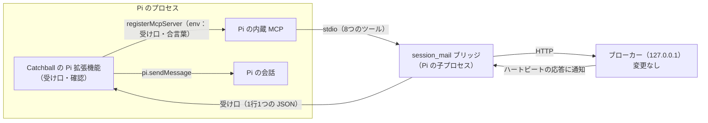

# 設計：Pi（pi-coding-agent）の参加と自動受信

> **この文書は実装前に書いた設計書です。** 何をするかは [pi-integration.md](pi-integration.md)（仕様書）にあります。この文書には、どう作るかと、その根拠になった調査・試作をまとめます。文中の「今の作り」は、2026-11-02 の `main` を指します。

- 状態：**未実装**（調査・実物での試験・試作まで済み）
- 対象の Pi：`@earendil-works/pi-coding-agent` 1.5.0（`earendil-works/pi`。コミット ff2c893 を読んだ）
- 方針：**要件を満たす最小の変更。** 変えるのは、ブリッジと、新しい Pi 拡張機能だけ

## 1. 調べたこと

### 1.1 Pi の作り（公式のドキュメントとソース）

| 項目 | 分かったこと | 出どころ |
|---|---|---|
| MCP | 内蔵している。`~/.pi/agent/mcp.json` に書くか、拡張機能から `pi.registerMcpServer` で登録する。同じ名前なら mcp.json が優先される | docs/mcp.md、docs/extensions.md「MCP Servers」 |
| ツールの見せ方 | 既定は `codemode` で、ツールはモデルに直接は見えない。`direct` にすると組み込みのツールと同じように見える。名前は `mcp__<サーバー>__<ツール>` | docs/mcp.md「Control tool exposure」 |
| 接続名 | MCP の `clientInfo.name` は `pi` | `packages/coding-agent/src/extensions/mcp/runtime.ts` |
| サーバーからの通知 | 受け手があるのは、ログ（`notifications/message`）とツール一覧の変更だけ。**それ以外は捨てる**。拡張機能に通知を渡す口もない | `packages/mcp/src/client.ts`（`handleNotification`）、`runtime.ts` |
| 会話への差し込み | `pi.sendMessage(message, { triggerTurn, deliverAs })`。待機中は `triggerTurn: true` ですぐ動き出す。作業中は `followUp` なら作業がすべて終わってから処理される | docs/extensions.md「pi.sendMessage」 |
| ツールの前の割り込み | `tool_call` のイベントで、実行の前に止められる（`{ block: true, reason }`）。`ctx.ui.confirm` で確認を出せる | docs/extensions.md「tool_call」 |
| 長く動く資源 | ソケットなどは、読み込みの時点ではなく `session_start` で始め、`session_shutdown` で閉じる | docs/extensions.md「Long-lived resources and shutdown」 |
| 入れ方 | `pi install <パス>`、設定の `packages`・`extensions`、起動時の `-e <パス>`。.js をそのまま読み込む | docs/packages.md、docs/extensions.md |
| 承認 | ツールを呼ぶたびの承認はない | docs/security.md |

ほかの人が作ったエージェント間メッセージの拡張機能（pi-c2c、@pi-orca/messages など）も、「拡張機能が `pi.sendMessage` で会話に差し込む」形でした（pi-c2c は中身を読んで確認。ほかはパッケージの説明による）。

### 1.2 実物での試験（2026-11-02、Haiku）

回避策（mcp.json に `SESSION_MAIL_PROVIDER=claude` と `exposure: "direct"`）を使い、Pi を RPC モードで起動したまま、順に頼みました。

| 手順 | 結果 |
|---|---|
| `pi mcp list` | `session_mail: connected, 8 tools (direct, global)` |
| ルームの作成・参加 | ✅ |
| 相手役（session-mail CLI）から送り、20 秒待つ | Pi は動かなかった。未取得が残った |
| 「受信して」「返信して」と頼む | ✅ 本文を読み、reply_to 付きで返信し、相手役が受け取った |
| 退出・削除 | ✅ 相手役が残っているあいだは `ROOM_NOT_EMPTY`。相手役の退出後に削除できた |
| WebUI | 手で受信したあと「自動受信 確認済み」と出た（**誤り**。ブリッジが、Pi に届かない `claude/channel` の通知を「書けた」と返していたため） |

### 1.3 試作

- 拡張機能が `session_start` で Unix ソケットを開き、代役のブリッジを `pi.registerMcpServer` で登録する。ソケットの場所は、環境変数で代役に渡す。
- 代役のブリッジは、3 秒後にソケットへ通知を1行送る。
- 拡張機能は、届いた通知を `pi.sendMessage(…, { triggerTurn: true, deliverAs: "followUp" })` で会話に入れる。

```
4.8s  agent_start                ← プロンプトなしで動き出した
4.8s  custom    「キャッチボールのテスト通知です。…」
6.6s  assistant 「受信しました」
6.6s  agent_settled
```

### 1.4 試験の環境で分かったこと（次に試す人へ）

- Pi は、作業用のフォルダーで `npm i --ignore-scripts @earendil-works/pi-coding-agent@1.5.0` とすれば入る（クラウド環境の安全判定は、スクリプトを動かすインストールを止めた）。
- 設定は、`PI_CODING_AGENT_DIR` で一時フォルダーに向けられる。モデルは `--provider anthropic --model claude-haiku-5-5`。
- クラウド環境では、`ANTHROPIC_API_KEY` という名前の環境変数はセッションの中で見えない。別の名前（例 `PI_ANTHROPIC_API_KEY`）で入れ、Pi を起動するときだけ `ANTHROPIC_API_KEY` として渡す（`env -i` で親の環境を外す）。
- 環境変数を変えたあとは、セッションが一時停止から再開したときに読み直される。

## 2. 方針：Claude と同じ種類として扱う

ブローカーから見ると、今の Claude は「ハートビートの応答で通知を手渡しされ、結果を次のハートビートで返す参加者」です。Pi もこれと同じにします。**違うのは、ブリッジから先の届け方（`claude/channel` か、受け口か）だけ**です。

そのため、ブローカーの次のしくみが、変更なしで Pi に効きます。

| しくみ | 今のコード |
|---|---|
| 会話 ID を求めない参加 | `core.selfJoin`（provider が claude なら会話 ID は要らない） |
| 通知の手渡し | `notifier.dispatch` の `claude_channel`（`pendingChannel`）、`http.ts` の heartbeat |
| 結果の記録・失敗の数え方・「要注意」 | `notifier.record` |
| 参加のあとの確認と「確認済み」 | `http.ts` の join のあとの `notifier.probe`、`core.receive` の確認済みの判定 |
| 未取得が残ったときの再通知（5・15・30 分） | `notifier.tick` の `claude_renotify_backoff_ms` |
| 失敗のあとの送り直し（30 秒・2 分・10 分） | `notifier.tick` の `retry_after_failure_ms`（D-019） |
| 再接続のときの通知 | `core.connect` の `force_on_connect` |

前の試験の誤表示は、ブリッジが「受け口から `written` が返ったときだけ `written` を返す」ようにするだけで直ります。

**受け入れること**：WebUI と `status` で、Pi の種類が「Claude」と出ます。「Pi」と出すには、DB の制約（`provider IN ('codex','claude')`）を変えて表を作り直す必要があるので、今回は入れません。

## 3. 比べた案

| 案 | 判断 |
|---|---|
| **A. 拡張機能（受け口）＋ 今のブリッジ。ブローカーには Claude と同じ種類（採用）** | 変更が最小。ツールは今のブリッジのまま |
| A'. A に加えて、ブローカーに種類 `pi` を足す | 「Pi」と表示されるだけで、要件には要らない。DB の移行、ブローカー、WebUI、管理用 CLI に手が入る |
| B. 拡張機能が8つのツールを持ち、ブローカーと直接話す | ツールの定義・検証・エラーの文面が二重になる |
| C. Pi を RPC で外から操る | Pi のふだんの画面（TUI）が使えない |
| D. 拡張機能がブローカーを問い合わせる | 参加のキーはブリッジのプロセスの中にしかなく、拡張機能からは使えない |
| E. MCP の別の通知を使う | Pi はそれを捨てるので届かない（§1.1） |

## 4. 全体の形



## 5. 部品ごとの変更

### 5.1 Pi 拡張機能（新しく作る）

- **置き場所**：リポジトリの中の Pi 用のフォルダー（例 `integrations/pi/`）。`package.json` に `"pi": { "extensions": ["./index.js"] }` を書く。
- **言語**：ビルドしない JavaScript（ESM）。Catchball の `tsc` の対象外にする。
- **ブリッジの場所**：拡張機能のファイルからの相対パスで、`dist/bridge/main.js` を探す。なければ、`session_start` で「npm run build をしてください」と知らせ（UI があれば `ctx.ui.notify`、なければ標準エラー）、登録しない。
- **`session_start`**
  1. OS の一時フォルダーの下に、本人だけが使えるフォルダーを作る（`fs.mkdtemp`、権限 0700）。Windows では、名前付きパイプ `\\.\pipe\catchball-pi-<乱数>` を使う。
  2. 合言葉（乱数 32 バイト）を作る。
  3. 受け口を開く（`net.createServer().listen(場所)`）。
  4. ブリッジを登録する：`pi.registerMcpServer("session_mail", { command: process.execPath, args: [ブリッジ], env, exposure: "direct" })`。
     - `env` に入れるもの：`SESSION_MAIL_PROVIDER=pi`、受け口の場所、合言葉。
     - Pi の環境に `SESSION_MAIL_HOME` があれば、それも入れる。
- **受け口**
  - 最初の1行が `hello` で、合言葉が合う接続だけを受け付ける。合わなければ切る。
  - `notify` が届いたら、`pi.sendMessage({ customType: "catchball", content, display: true }, { triggerTurn: true, deliverAs: "followUp" })` を呼ぶ。例外がなければ `written`、あれば `error` を返す。
- **`tool_call`**
  - `mcp__session_mail__channel_leave` と `mcp__session_mail__channel_room_delete` のときだけ、`ctx.ui.confirm` で聞く。
  - 断られたら `{ block: true, reason: "ユーザーが断りました。ユーザーの指示を待ってください。" }` を返す。
- **`session_shutdown`**：受け口を閉じ、フォルダーを消す。2回呼ばれても問題がないようにする。
- `/reload` などで `session_start` がもう一度来たら、前の受け口を閉じてから開き直し、登録し直す。ブリッジは起動し直されるので、会話の中から参加していた場合は参加し直しになる。今の「MCP サーバーの再起動」と同じ扱い。

### 5.2 ブリッジ（`src/bridge/main.ts`）

- **種類の判定（`provider()`）**
  - `SESSION_MAIL_PROVIDER` が `pi`、または接続名が `pi` のとき、ブローカーには `claude` として参加する（`/api/join/self` と `/api/agent/connect` に渡す値）。
  - それ以外は今のまま。
- **受け口への受け渡し（`heartbeat` の中）**
  - 受け口の場所が環境変数にあるときは、ハートビートの応答の通知を `notifications/claude/channel` で送らず、受け口へ `notify` として送る。
  - 返事を最大で数秒待ち、`written` か `error` を、今の `results` に入れる。次のハートビートでブローカーに返る（今の Claude と同じ）。
  - 受け口へのつなぎ方：最初の通知のときにつなぎ、`hello` を送る。切れていたら、次の通知のときにつなぎ直す。
- **受け口がない Pi**（mcp.json だけで登録した Pi）
  - 通知は `error`（「Pi の拡張機能がありません。…」）として返す。
  - ブローカーは失敗として記録し、続けば WebUI に「要注意」と、その理由を出す。
- **変えないこと**：ツール、`claude/channel` の宣言（Pi は知らない宣言を無視する）、ブローカーとの API。

### 5.3 変えない部品

ブローカー（`src/broker/`）、DB（`SCHEMA`）、WebUI（`src/web/`）、管理用 CLI（`src/cli/`）、AI に渡す文面（`src/shared/text.ts`）、設定（`src/shared/config.ts`）。

## 6. 受け口とのやり取り

**形（1行に1つの JSON。この4つだけ）**

```jsonc
// ブリッジ → 拡張機能
{"type":"hello","secret":"<合言葉>"}
{"type":"notify","notify_id":"n_…","content":"<通知文（本文なし）>"}
// 拡張機能 → ブリッジ
{"type":"result","notify_id":"n_…","result":"written"}
{"type":"result","notify_id":"n_…","result":"error","error":"<理由>"}
```

- 通知文は、ブローカーが作った今の文面（件数と送信元の ID だけ）を、そのまま流す。
- 知らない `type` は無視する。
- 合言葉と通知文は、ログに書かない。

## 7. 動きの流れ

**起動と参加**
1. Pi が起動する。拡張機能が受け口を開き、ブリッジを登録する。Pi の MCP がブリッジを起動する。
2. ユーザーが参加を頼み、Pi が `channel_join` を呼ぶ。ブリッジは `claude` として参加する。
3. ブローカーが確認用の通知を出す。ブリッジがハートビートで受け取り、受け口へ送る。拡張機能が会話に入れ、`written` を返す。
4. Pi が動き出し、`channel_receive` を呼ぶ。ブローカーが「確認済み」にする。

**新着**
1. 相手が Pi に送る。2 秒の待ち（`debounce_ms`）のあと、ブローカーが通知を置く。
2. 次のハートビート（最大 5 秒）で、ブリッジが受け口へ送る。拡張機能が会話に入れる。
3. Pi が待機中ならすぐ、作業中なら作業のあとに、受信する。
4. 未取得が残っているあいだは、新しい通知を重ねない。残ったままなら、5・15・30 分で通知し直す。

**失敗**

| 起きたこと | 動き |
|---|---|
| 受け口につながらない・返事が来ない | ブリッジが `error` を返す。ブローカーが 30 秒・2 分・10 分で送り直す。3 回続けて失敗すると「要注意」になる |
| `pi.sendMessage` が例外になる | 拡張機能が `error` と理由を返す（同上） |
| Esc で中断して、待っていた通知が流れた | 未取得が残るので、5 分後の再通知で受信される（実物で確かめる） |
| Pi を終了した | ブリッジも終わり、切断になる。起動して参加し直すと、再接続の通知が出る |
| mcp.json にも session_mail がある | mcp.json の登録が優先され、そのブリッジには受け口がない。通知の失敗として「Pi の拡張機能がありません」と出るので、mcp.json の登録を消してもらう |

## 8. 安全性（AGENTS.md の決まりとの関係）

| 決まり | この設計で |
|---|---|
| AI 用の API は 127.0.0.1 だけ | 変えない。受け口は Unix ソケット・名前付きパイプで、ネットワークに出ない |
| 送信元はトークンで決める | 変えない。拡張機能はツールを持たない |
| 承認をメッセージで中継しない | 変えない。確認は、Pi の画面でユーザーに聞くだけ |
| 通知に本文を入れない | 変えない。受け口に流すのは今の通知文だけ |
| WebUI は textContent だけ | WebUI を変えない |
| ログにトークンや本文を書かない | 合言葉と通知文も書かない |

受け口に偽の通知を入れられても、本文は入らず、ブリッジの権限も得られません。Pi に受信を促すだけです。それでも、本人だけのフォルダーと合言葉で守ります。

## 9. 実装の順番

1. ブリッジ：種類の判定と、受け口への受け渡し。自動試験（境目1）。
2. 拡張機能。自動試験（境目2）。
3. 実物の Pi（Haiku）での結合試験。`docs/verification/` に記録する。
4. ドキュメント：
   - ARCHITECTURE、OPERATIONS（Pi の導入と起動）、MCP_TOOLS（Pi だけの違いを短く）
   - DECISIONS（新しい D 番号）、REQUIREMENTS、ROADMAP（F-5 を片付ける）、CHANGELOG
   - README（日本語と英語）

## 10. 出どころ

- Pi の拡張機能：https://github.com/earendil-works/pi/blob/main/packages/coding-agent/docs/extensions.md
- Pi の MCP：https://github.com/earendil-works/pi/blob/main/packages/coding-agent/docs/mcp.md
- Pi のセキュリティ：https://github.com/earendil-works/pi/blob/main/packages/coding-agent/docs/security.md
- pi-c2c：https://pi.dev/packages/pi-c2c
- @pi-orca/messages：https://pi.dev/packages/@pi-orca/messages
- クラウド環境の環境変数：https://code.claude.com/docs/en/cloud-environments
