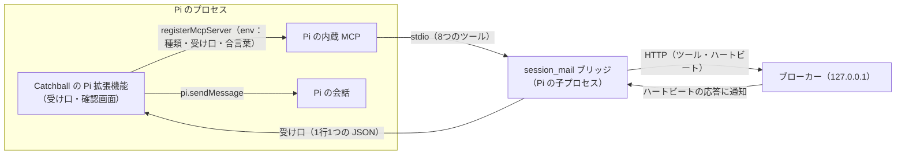

# 設計：Pi（pi-coding-agent）の参加と自動受信

> **この文書は実装前に書いた設計書です。** 機能の仕様（何をするか）は [pi-integration.md](pi-integration.md) にあります。この文書は、どう作るかと、その根拠になった調査・試作をまとめます。文中の「今の作り」は、2026-11-02 の `main`（ca4d1c2）を指します。

- 状態：**未実装**（調査・実物での試験・試作まで済み）
- 対象の Pi：`@earendil-works/pi-coding-agent` 1.5.0（リポジトリは `earendil-works/pi`。旧名 pi-mono。コミット ff2c893 を読んだ）

## 1. 目的

Pi のセッションを、Codex・Claude と同じ「ルームの参加者」として扱えるようにします。新着が届いたら、Pi が**自分から**受信して対応するようにします。

## 2. 調べたこと

### 2.1 Pi の作り（公式のドキュメントとソース）

| 項目 | 分かったこと | 出どころ |
|---|---|---|
| MCP | 内蔵している。stdio と streamable HTTP に対応する。設定は `~/.pi/agent/mcp.json`（プロジェクトでは `.pi/mcp.json`）に書くか、拡張機能から `pi.registerMcpServer` で登録する | docs/mcp.md、docs/extensions.md「MCP Servers」 |
| ツールの見せ方 | 既定は `codemode`。この場合、ツールはモデルに直接は見えず、スクリプトから探して呼ぶ形になる。`direct` にすると、組み込みのツールと同じようにモデルに見える。ツール名は `mcp__<サーバー>__<ツール>` | docs/mcp.md「Control tool exposure」 |
| 接続のときの名前 | MCP の `clientInfo.name` は `pi` | `packages/coding-agent/src/extensions/mcp/runtime.ts`（`connectOnce`） |
| サーバーからの通知 | `notifications/progress` と `notifications/cancelled` は内部で処理する。受け手を登録しているのは `notifications/message`（ログに書く）と `notifications/tools/list_changed` だけ。**それ以外は捨てる** | `packages/mcp/src/client.ts`（`handleNotification`）、`runtime.ts` |
| 拡張機能に通知を渡す口 | ない（拡張機能の API に、MCP の通知を受け取るものはない） | docs/extensions.md、`src/core/extensions/types.ts` |
| サーバーの instructions | `codemode` と `deferred` のサーバーだけ、最初の1行がシステムプロンプトの一覧に載る。全文はスクリプトから読む形 | docs/mcp.md、`src/extensions/mcp/index.ts` |
| 会話への差し込み | `pi.sendMessage(message, { triggerTurn, deliverAs })` で差し込める。待機中なら `triggerTurn: true` ですぐ動き出す。作業中は `deliverAs` で決まる。`steer` は今のツールの実行が終わったら、`followUp` は作業がすべて終わったら、`nextTurn` は次の入力まで待つ | docs/extensions.md「pi.sendMessage」 |
| ツールの前の割り込み | `tool_call` のイベントで、実行の前に止められる（`{ block: true, reason }`）。`ctx.ui.confirm` で確認画面を出せる。`ctx.hasUI` は TUI と RPC で true、`-p` と JSON で false | docs/extensions.md「tool_call」「ctx.hasUI」 |
| 長く動く資源 | 拡張機能を読み込んだ時点では、ソケットやタイマーを始めない。`session_start` で始め、`session_shutdown` で閉じる | docs/extensions.md「Long-lived resources and shutdown」 |
| 拡張機能の置き場所 | `~/.pi/agent/extensions/`、設定の `extensions`・`packages`、`pi install <パス>`、起動時の `-e <パス>`。.ts も .js もそのまま読み込む | docs/extensions.md「Extension Locations」、docs/packages.md |
| 承認 | ツールを呼ぶたびの承認はない | docs/security.md |
| mcp.json と登録の重なり | 同じ名前なら mcp.json が優先される | docs/extensions.md「MCP Servers」 |

### 2.2 ほかの人が作った、エージェント間のメッセージの拡張機能

| 拡張機能 | 届け方 |
|---|---|
| pi-c2c | 受信箱を問い合わせ、`pi.sendMessage` で会話に入れる。急ぎは `triggerTurn` と `steer`、急ぎでないものは `followUp` |
| @pi-orca/messages | 待機中のセッションに、問い合わせの間隔ごとに未読を届ける |
| @baochunli/pi-collaborating-agents | 急ぎは `steer` で割り込み、ふつうは後回しにする |

どれも「拡張機能が会話に差し込む」形でした。Pi で自動的に届けるには、この形が標準です（pi-c2c は、公開されているパッケージの中身を読んで確かめました。ほかの2つは、パッケージの説明によります）。

### 2.3 実物での試験（2026-11-02、このクラウド環境、Haiku）

回避策（mcp.json に `SESSION_MAIL_PROVIDER=claude`、`exposure: "direct"`）で、Pi を RPC モードで起動したまま、順に頼みました。

| 手順 | 結果 |
|---|---|
| `pi mcp list` | `session_mail: connected, 8 tools (direct, global)` |
| ルーム pi-test を作る | ✅ `channel_room_create` |
| ID pi で参加する | ✅ `channel_join` |
| 相手役（session-mail CLI）から送り、20 秒待つ | Pi は動かなかった（エージェントの実行は0回）。未取得の1件が残った |
| 「受信して」と頼む | ✅ 本文を正しく読んだ |
| 「返信して」と頼む | ✅ reply_to 付きで返信し、相手役が受け取った |
| 退出・削除 | ✅ 相手役が残っているあいだは `ROOM_NOT_EMPTY` で断られ、相手役の退出後に削除できた |
| WebUI の表示 | 手で受信したあと「自動受信 確認済み」になった（**誤り**。§5.5） |

### 2.4 試作（自動で動き出すかどうか）

次の試作で、**プロンプトを送らなくても Pi が動き出す**ことを確かめました。

- 拡張機能が `session_start` で Unix ソケットを開く。
- 拡張機能が、代役のブリッジを `pi.registerMcpServer` で登録し、ソケットの場所を環境変数で渡す。
- 代役のブリッジは、3 秒後にソケットへ通知を1行送る。
- 拡張機能は、それを `pi.sendMessage(…, { triggerTurn: true, deliverAs: "followUp" })` で会話に入れる。

```
4.8s  agent_start
4.8s  custom    「キャッチボールのテスト通知です。『受信しました』とだけ答えてください。」
6.6s  assistant 「受信しました」
6.6s  agent_settled
```

試作の拡張機能の要点（このまま使うのではなく、決まったことを示すために載せます）：

```js
pi.on("session_start", async () => {
  srv = net.createServer(conn => { /* 1行ずつ JSON を読む */
    pi.sendMessage({ customType: "catchball", content: n.content, display: true },
                   { triggerTurn: true, deliverAs: "followUp" });
    conn.write(JSON.stringify({ notify_id: n.notify_id, result: "written" }) + "\n");
  });
  await listen(srv, sock);
  pi.registerMcpServer("stub", { command: "node", args: [bridge], env: { CATCHBALL_PI_SOCK: sock } });
});
pi.on("session_shutdown", async () => { srv?.close(); rm(sock); });
```

### 2.5 試験の環境で分かったこと（次に試す人へ）

- Pi は、作業用のフォルダーで `npm i --ignore-scripts @earendil-works/pi-coding-agent@1.5.0` とすれば入る（クラウド環境の安全判定は、スクリプトを動かす形のインストールを止めた）。
- Pi の設定は `PI_CODING_AGENT_DIR` で一時フォルダーに向けられる。モデルは `--provider anthropic --model claude-haiku-5-5`。
- クラウド環境では、環境変数の名前を `ANTHROPIC_API_KEY` にするとセッションの中で見えない。別の名前（例 `PI_ANTHROPIC_API_KEY`）で入れ、Pi を起動するときだけ `ANTHROPIC_API_KEY` として渡す（`env -i` で親の環境を外す）。
- 環境変数を変えたあとは、セッションが一時停止から再開したときに読み直される。新しいセッションは要らない。

## 3. 比べた案

| 案 | 形 | 判断 |
|---|---|---|
| **A. 拡張機能 ＋ 今のブリッジ（採用）** | 拡張機能がブリッジを登録し、受け口の場所を環境変数で渡す。ブリッジは通知を受け口へ送り、拡張機能が会話に入れる | ツールは今のブリッジのまま。変更が小さく、Codex・Claude と同じ部品を使う |
| B. 拡張機能だけ | 拡張機能が8つのツールを持ち、ブローカーと直接話す | ツールの定義・検証・エラーの文面が二重になる。直すたびに2か所を直す必要がある |
| C. Pi を RPC で外から操る | 外の見張り役が Pi に `prompt` を送る | Pi のふだんの画面（TUI）が使えない |
| D. 拡張機能がブローカーを問い合わせる | 拡張機能が定期的に未取得を問い合わせる | 参加の鍵（会話の中から参加したときのキー）はブリッジのプロセスの中にしかなく、拡張機能からは使えない。管理用の鍵を使うのは権限が強すぎる |
| E. MCP の別の通知（resources/updated など）を使う | ― | Pi は受け手を登録していないので届かない（§2.1） |

## 4. 全体の形



- ブローカーから見ると、Pi は「ハートビートで通知を手渡しする参加者」です（今の Claude と同じ）。違うのは、ブリッジから先の届け方だけです。
- 受け口は Pi のプロセスの中にあり、ブリッジは Pi の子プロセスです。どちらも同じ PC の同じユーザーで動きます。

## 5. 部品ごとの変更

### 5.1 Pi 拡張機能（新しく作る）

- 置き場所：リポジトリの中の Pi 用のフォルダー（例 `integrations/pi/`）。`package.json` に `"pi": { "extensions": ["./index.js"] }` を書き、Pi のパッケージの形にする。
- 言語：ビルドしない JavaScript（ESM）。Catchball の `tsc` の対象外。Pi の型は使わない。
- ブリッジの場所：拡張機能のファイルからの相対パスで、Catchball の `dist/bridge/main.js` を探す。ない場合は、`session_start` で `ctx.ui.notify`（UI がなければ標準エラー）に「npm run build をしてください」と出し、登録しない。
- `session_start` でやること：
  1. 受け口の場所と合言葉を作る（§6）。
  2. 受け口を開く。
  3. `pi.registerMcpServer("session_mail", { command: <node の実行ファイル>, args: [<ブリッジ>], env, exposure: "direct" })` を呼ぶ。`env` には、`SESSION_MAIL_PROVIDER=pi`、受け口の場所、合言葉、`SESSION_MAIL_HOME`（あれば）を入れる。
  4. `pi.getMcpServers()` で、mcp.json に同じ名前があるか（登録が負けていないか）を確かめ、あれば知らせる。
- 受け口に届いた通知：合言葉を確かめてから、`pi.sendMessage({ customType: "catchball", content, display: true, details: { notify_id, kind, unread } }, { triggerTurn: true, deliverAs: "followUp" })` を呼ぶ。結果を返す。
- `tool_call`：`mcp__session_mail__channel_leave` と `mcp__session_mail__channel_room_delete` のとき、`ctx.hasUI` なら `ctx.ui.confirm` を出す。断られたら `{ block: true, reason: "ユーザーが断りました。…" }` を返す。UI がないときの扱いは、仕様書 §7-2 で決める。
- `session_shutdown`：受け口を閉じ、ソケットのファイルを消す。同じセッションで2回呼ばれても問題がないようにする。
- `/reload` やセッションの切り替えのあと：`session_start` がもう一度来る。前の受け口を閉じてから開き直し、`registerMcpServer` をもう一度呼ぶ（同じ名前の登録は置き換わる）。ブリッジは新しい環境変数で起動し直され、参加し直しが必要になる（今の「MCP サーバーの再起動」と同じ扱い）。

### 5.2 ブリッジ（`src/bridge/main.ts`）

- 種類の判定：`SESSION_MAIL_PROVIDER` が `codex`・`claude`・`pi` ならそれに従う。なければ、`clientInfo.name` が `pi` なら Pi、Claude を含めば Claude、それ以外は Codex。
- Pi の受け口：環境変数に受け口の場所と合言葉があれば、ブリッジの起動時につなぐ。切れたら、次の通知のときにつなぎ直す。
- ハートビートの応答に通知があったとき：
  - Claude：今と同じ（`notifications/claude/channel`）。
  - Pi：受け口へ送り、返ってきた結果（または、つながらない・時間切れのときの `error`）を、次のハートビートで返す。待つのは最大で数秒（設定で変えられる）。
- 接続（`/api/agent/connect`）のときに、受け口があるかどうかを伝える。ブローカーは、ないときに「自動受信 未設定」にする。
- `claude/channel` の宣言（capabilities）は今のまま残す。Pi は知らない宣言を無視する。

### 5.3 ブローカー

- `src/shared/config.ts`：`Provider` に `pi` を足す。
- `src/broker/db.ts`：`participants` の `provider` の制約に `pi`、`receiver_kind` の制約に `pi_extension` を足す。今の DB ファイルの扱いは、仕様書 §7-1 で決める（推奨は、起動時に表を作り直す移行）。
- `src/broker/core.ts`：
  - 会話の中からの参加（`selfJoin`）と `provision` で `pi` を受け付ける。会話 ID は求めない。`receiver_kind` は `pi_extension`。
  - 接続のとき、ブリッジが「受け口なし」と伝えたら、`receiver_state` を `not_configured` にし、理由を「Pi の拡張機能が入っていません」にする。
- `src/broker/notifier.ts`：
  - `pi_extension` は、`claude_channel` と同じく、ハートビートで手渡しする（`pendingChannel` に置く）。
  - 時間ごとの再通知（`claude_renotify_backoff_ms`）は Claude だけのまま。Pi にはしない。
  - 「直前にツールを使っていたら少し待つ」は Codex だけのまま。
  - 失敗のあとの送り直し（D-019）と、再接続時の通知は、種類を問わず今のまま。
- `src/broker/http.ts`：ハートビートで返った Pi の結果を、Claude と同じく `record` に渡す（今のコードのままで足りる見込み）。
- `src/cli/admin.ts`：`provision --provider pi`。Pi 用の起動の案内（拡張機能を入れて `pi` を起動する）を出す。

### 5.4 WebUI（`src/web/`）

- 種類の表示に「Pi」を足す。番号のアイコンの色（CSS の `.av.pi`）を1つ足す。凡例があれば、それにも足す。

### 5.5 「自動受信 確認済み」の誤表示（回避策で起きたこと）

- 今の判定：通知を出したあと、同じ接続の世代のうちに受信があれば「確認済み」にする。
- 回避策（Claude 扱い）では、ブリッジが Claude 用の通知を「書けた」と返す。Pi はそれを捨てるが、そのあと手で受信すると「確認済み」になった。
- この設計では、Pi の通知は拡張機能が会話に入れたときだけ `written` になる。受け口がなければ「未設定」で、確認用の通知も出さない。これで誤表示はなくなる。

### 5.6 AI に渡す文面（`src/shared/text.ts`）とツールの説明

- `channel_join` の説明の「Codex の場合は conversation_id …」は今のまま（Pi には当てはまらないことが分かる書き方になっている）。
- 通知文と運用指示は、今のものを使う。Pi は拡張機能から入った文面を、ユーザーの入力と同じように読む（試作で確認）。

## 6. 受け口とやり取りの形

**場所**
- Linux・Mac：Unix ソケット。`SESSION_MAIL_HOME` の下の、本人だけが使えるフォルダー（権限 0700）に、`pi-<Pi のプロセス番号>-<乱数>.sock` として作る。Unix ソケットのパスは長さに上限（約 100 バイト）があるので、長すぎるときは OS の一時フォルダーの下の、本人だけのフォルダーを使う。
- Windows：名前付きパイプ `\\.\pipe\catchball-pi-<プロセス番号>-<乱数>`。

**合言葉**
- `session_start` のたびに、乱数（32 バイト）を作る。環境変数でブリッジにだけ渡す。ファイルには書かない。
- ブリッジは、つないだら最初の1行で合言葉を送る。拡張機能は、合わなければすぐ切る。比べるときは、時間で中身が漏れない比べ方を使う。

**形（1行に1つの JSON）**

```jsonc
// ブリッジ → 拡張機能
{"type":"hello","secret":"<合言葉>","bridge_version":"<版>"}
{"type":"notify","notify_id":"n_…","kind":"mail_notice","unread":2,"content":"<通知文（本文なし）>"}
// 拡張機能 → ブリッジ
{"type":"hello_ok","extension_version":"<版>"}
{"type":"result","notify_id":"n_…","result":"written"}
{"type":"result","notify_id":"n_…","result":"error","error":"<理由>"}
```

- `kind` は `probe`（参加時の確認）か `mail_notice`（新着）。
- 知らない `type` は無視する（あとで足せるように）。
- 合言葉と本文は、ログに書かない。

## 7. 動きの流れ

**起動と参加**
1. Pi が起動し、拡張機能の `session_start` が来る。受け口を開き、ブリッジを登録する。
2. Pi の MCP がブリッジを起動する。ブリッジは受け口につなぎ、合言葉で確かめ合う。
3. ユーザーが「ルーム proj-a に ID pi で参加して」と頼む。Pi が `channel_join` を呼ぶ。ブローカーは Pi として登録する。
4. ブリッジが接続し、確認用の通知（probe）がハートビートで届く。ブリッジは受け口へ送り、拡張機能が会話に入れる。Pi は動き出して `channel_receive` を呼ぶ。ブローカーは「確認済み」にする。

**新着**
1. 相手が Pi に送る。ブローカーは、少し待って（`debounce_ms`）、通知を Pi の分として置く。
2. 次のハートビート（最大 5 秒）で、ブリッジが通知を受け取り、受け口へ送る。
3. 拡張機能が `pi.sendMessage` を呼び、`written` を返す。ブリッジは、次のハートビートでそれを返す。
4. Pi が待機中なら、すぐ動き出して受信する。作業中なら、作業が終わってから受信する。
5. 未取得があるあいだは、新しい通知は重ねない（今の「1件まで」）。受信で未取得がなくなれば、次の新着でまた通知する。

**失敗**
| 起きたこと | 動き |
|---|---|
| 受け口につながらない・時間切れ | ブリッジが `error` を返す。ブローカーは失敗を記録し、D-019 の間隔（30 秒・2 分・10 分）で送り直す。続けて失敗すると、WebUI で「要注意」にする |
| `pi.sendMessage` が例外 | 拡張機能が `error` と理由を返す（同上） |
| Pi が終了した | ブリッジも終わる。ブローカーは切断として扱う。次に起動して参加し直すと、再接続の通知が出る |
| 受け口の合言葉が違う | 拡張機能が切る。ブリッジは `error` を返す |
| mcp.json に session_mail がある | 拡張機能の登録が負ける。拡張機能が画面に知らせる。mcp.json の登録で動いたブリッジには受け口がないので、「自動受信 未設定」になる |
| Esc で中断したあとの、待っていた通知 | 実物で確かめる（仕様書 §7-4） |

## 8. 安全性（AGENTS.md の決まりとの関係）

| 決まり | この設計で |
|---|---|
| AI 用の API は 127.0.0.1 だけ | 変えない。受け口は Unix ソケット・名前付きパイプで、ネットワークに出ない |
| 送信元はトークンで決める | 変えない。拡張機能はツールを持たず、送信は今のブリッジを通る |
| 承認をメッセージで中継しない | 変えない。拡張機能の確認画面は、Pi の画面でユーザーに聞くだけ |
| 通知に本文を入れない | 変えない。受け口に流すのは、今の通知文（件数と送信元の ID）だけ |
| WebUI は textContent だけ | 変えない（種類の表示を足すだけ） |
| トークンはハッシュだけ・ログに本文やトークンを書かない | 合言葉もログに書かない。ファイルにも残さない |

受け口に偽の通知を入れられても、本文は入らず、ブリッジの権限も得られません。Pi に「受信しなさい」と促すだけです。それでも、同じ PC のほかのユーザーから入れないように、権限と合言葉で守ります。

## 9. 試験

仕様書 §5 のとおりです。実装の順番は次のとおりです。

1. ブローカー：`pi` の種類と DB の制約（移行を含む）。自動試験：`selfJoin`・`provision` で Pi が登録され、会話 ID を求められないこと。
2. ブリッジ：種類の判定と受け口への受け渡し。自動試験：試験が受け口を開き、接続名 `pi` の MCP クライアントでブリッジを起動する（境目1）。
3. 拡張機能：偽の Pi の API で読み込む試験（境目2）。
4. WebUI と管理用 CLI の表示。
5. 実物の Pi（Haiku）での結合試験。`docs/verification/` に記録する。
6. ドキュメント：ARCHITECTURE・OPERATIONS・MCP_TOOLS・DECISIONS（新しい D 番号）・REQUIREMENTS・ROADMAP・CHANGELOG・README（日本語と英語）。

## 10. 出どころ

- Pi の拡張機能：https://github.com/earendil-works/pi/blob/main/packages/coding-agent/docs/extensions.md
- Pi の MCP：https://github.com/earendil-works/pi/blob/main/packages/coding-agent/docs/mcp.md
- Pi の RPC：https://github.com/earendil-works/pi/blob/main/packages/coding-agent/docs/rpc.md
- Pi のセキュリティ：https://github.com/earendil-works/pi/blob/main/packages/coding-agent/docs/security.md
- pi-c2c：https://pi.dev/packages/pi-c2c
- @pi-orca/messages：https://pi.dev/packages/@pi-orca/messages
- クラウド環境の環境変数：https://code.claude.com/docs/en/cloud-environments
